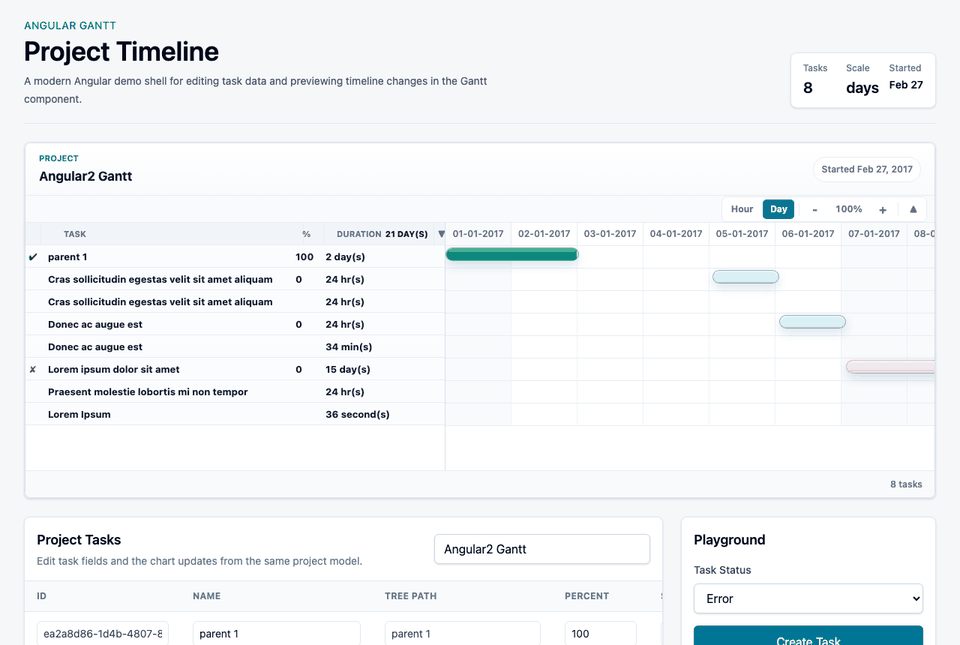

# Angular Gantt

A Gantt chart demo application built with modern Angular. The project started as an Angular 2 component experiment and has been migrated to the current Angular CLI application build system with Tailwind CSS for the demo UI.

## Stack

- Angular 21
- Angular CLI application builder
- Vite-backed Angular dev server
- Tailwind CSS 4
- TypeScript 5.9
- RxJS 7

## Getting Started

Install dependencies:

```bash
npm install
```

Run the local development server:

```bash
npm start
```

Open the app at:

```text
http://127.0.0.1:4200/
```

You can also run:

```bash
npm run dev
```

## Build

Create a production build:

```bash
npm run build
```

Build output is written to:

```text
dist/angular2-gantt/browser
```

## Project Structure

```text
src/demo-app
```

Contains the Angular demo application shell, global styles, and sample project/task data.

```text
src/lib
```

Contains the reusable Gantt module, components, services, pipes, and shared interfaces.

Important files:

- `angular.json` - Angular workspace and build configuration
- `tsconfig.json` - shared TypeScript configuration
- `tsconfig.app.json` - application TypeScript entrypoints
- `.postcssrc.json` - Tailwind CSS PostCSS integration
- `src/demo-app/styles.css` - global styles and Tailwind import

## Styling

Tailwind CSS is wired through PostCSS:

```css
@import "tailwindcss";
```

The demo shell uses Tailwind utility classes for layout, tables, controls, and panels. The Gantt component still keeps most of its original component-local styles so the chart internals remain self-contained.

## Demo



## Status

This project is still alpha-quality and intended as a working demo/migration base. The API and component internals may change as the Gantt component is modernized further.

## License

MIT
